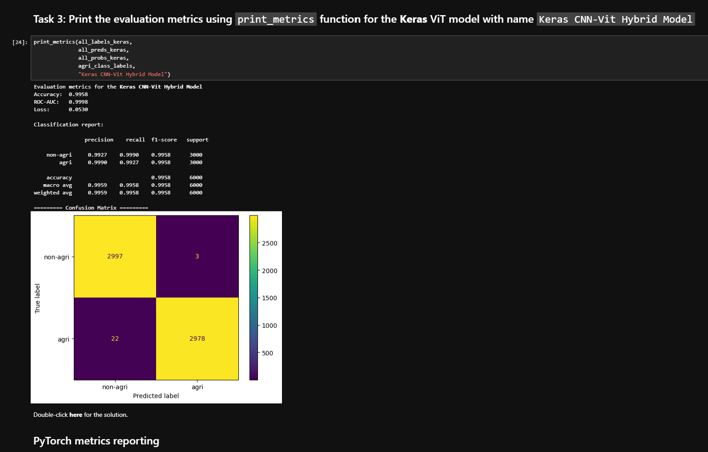
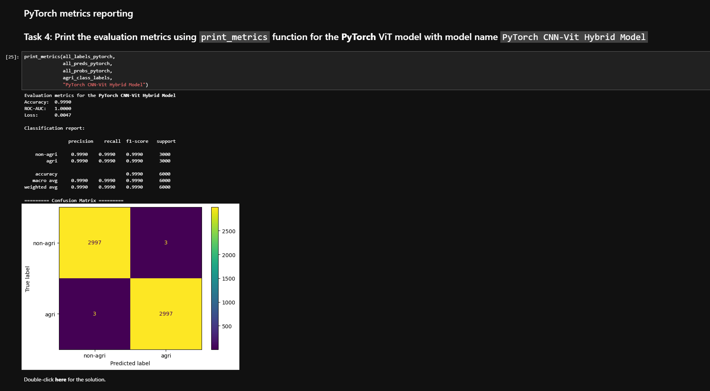
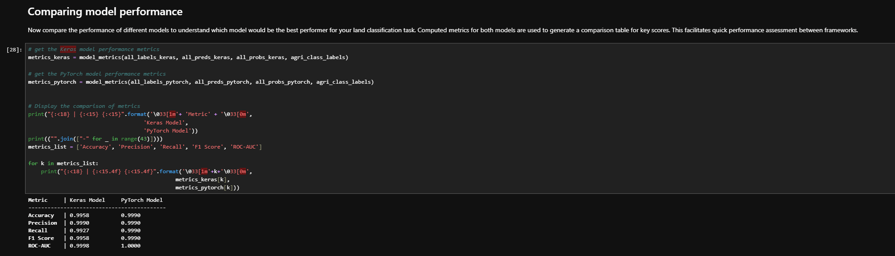

# Agricultural Land Classification from Satellite Images — CNNs & Vision Transformers

Final capstone project of the **IBM AI Engineering Professional Certificate** (Coursera course: *AI Capstone Project with Deep Learning*).

The project classifies satellite image tiles as **agricultural** or **non-agricultural** land and compares
**Keras/TensorFlow** and **PyTorch** at every stage: data loading, augmentation, CNN classifiers, and
hybrid **CNN–Vision Transformer** models.

**Author:** Saleh Khaled Saleh Alzhrani

---

## Dataset

- About 6,000 satellite image tiles, two balanced classes:
  - `class_0_non_agri`: non-agricultural land (≈3,000 images)
  - `class_1_agri`: agricultural land (≈3,000 images)
- Images are resized to **64 × 64** RGB.
- The dataset is provided by IBM Skills Network inside the course labs and is **not included** in this repository.

## Project structure

| # | Notebook | What it covers |
|---|---|---|
| 1 | `Q1_Memory_vs_Generator_Data_Loading.ipynb` | Memory-based (bulk) vs generator-based (lazy) image loading |
| 2 | `Q2_Data_Loading_Augmentation_Keras.ipynb` | Custom Keras data generator, `image_dataset_from_directory`, augmentation layers |
| 3 | `Q3_Data_Loading_Augmentation_PyTorch.ipynb` | `ImageFolder`, custom `Dataset`, `DataLoader`, torchvision transforms |
| 4 | `Q4_Train_Evaluate_Keras_Classifier.ipynb` | Keras CNN (4 Conv2D + 5 Dense layers), checkpointing, loss curves |
| 5 | `Q5_Implement_Test_PyTorch_Classifier.ipynb` | PyTorch CNN, explicit training loop, validation, predictions |
| 6 | `Q6_Comparative_Analysis_Keras_PyTorch.ipynb` | Fair comparison: accuracy, precision, recall, F1, ROC-AUC, confusion matrices |
| 7 | `Q7_Vision_Transformers_Keras.ipynb` | CNN–ViT hybrid in Keras (CNN feature map → patch tokens → transformer blocks) |
| 8 | `Q8_Vision_Transformers_PyTorch.ipynb` | CNN–ViT hybrid in PyTorch; depth/heads comparison (training time & validation loss) |
| 9 | `Q9_CNN_ViT_Integration_Evaluation.ipynb` | Evaluation of pre-trained Keras and PyTorch CNN–ViT hybrids |

## Methods

- **Data handling:** bulk vs lazy loading, train/validation split (80/20), on-the-fly augmentation (flips, rotations, zoom).
- **CNN classifiers:** convolution + pooling + batch normalization blocks, dropout, Adam optimizer, binary / cross-entropy loss.
- **Vision Transformers:** a CNN extracts local features; its feature map is split into tokens, given positional embeddings, and passed through multi-head self-attention blocks to capture global context.
- **Evaluation:** accuracy, precision, recall, F1-score, ROC-AUC, log loss, confusion matrix, ROC curves.

## Results

<!-- Fill in the numbers from your own executed notebooks -->

| Model | Accuracy | Precision | Recall | F1 | ROC-AUC |
|---|---|---|---|---|---|
| Keras CNN | | | | | |
| PyTorch CNN | | | | | |
| Keras CNN–ViT hybrid | | | | | |
| PyTorch CNN–ViT hybrid | | | | | |

### Screenshots

<!-- After uploading images to the screenshots folder, they will show here -->

## Tools

Python · TensorFlow / Keras · PyTorch / torchvision · scikit-learn · NumPy · Matplotlib · Jupyter

## How to run

1. Install the libraries: `pip install tensorflow torch torchvision scikit-learn matplotlib pillow tqdm`
2. Place the dataset so a folder contains `class_0_non_agri/` and `class_1_agri/`.
3. Open a notebook and run all cells. Each notebook locates the dataset folder automatically.

## Key takeaways

- Lazy (generator-based) loading keeps memory use small and scales to datasets larger than RAM.
- With identical data, architecture and hyperparameters, Keras and PyTorch reach comparable performance; Keras is faster to prototype, PyTorch gives finer control.
- Hybrid CNN–ViT models combine local feature extraction with global attention; making the transformer deeper multiplies training time without necessarily lowering validation loss.
